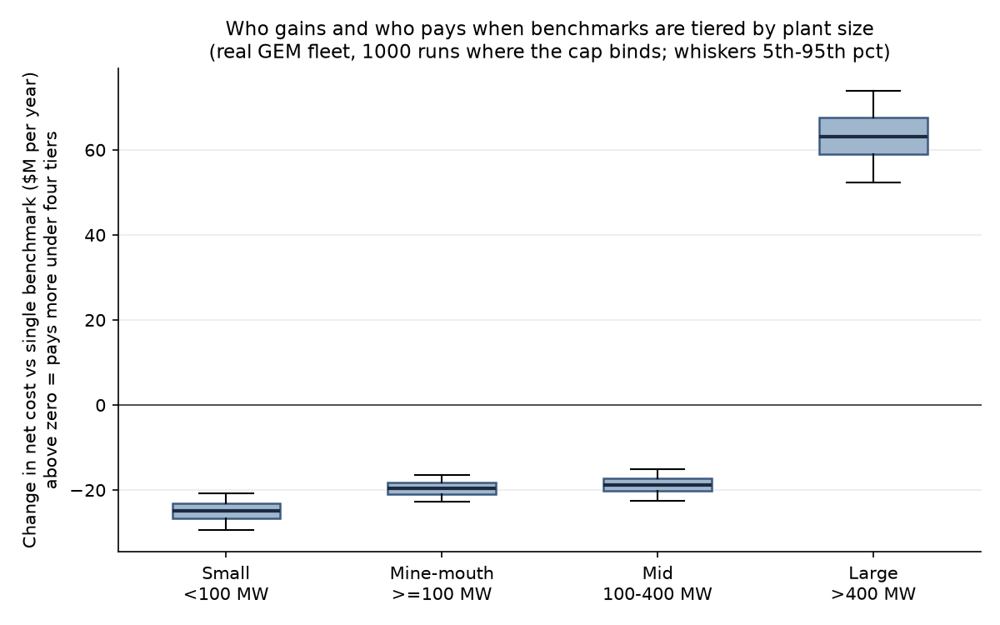

# Indonesia ETS Model

A small, reproducible Python model of Indonesia's power-sector emissions trading scheme (ETS), built step by step with numpy, pandas and matplotlib. The main question: **does giving big and small coal plants different emission benchmarks (tiering) change the carbon price, or only who pays?**

Status: complete through Stage 4b. This is a learning and portfolio project, not a forecast and not policy advice.

## Main finding so far

With tradable allowances and fixed generation, tiering the benchmark by plant size **does not change the carbon price or total abatement**. It only moves money between plants. On the real Indonesian coal fleet (Stage 4b), large non-mine-mouth plants (over 400 MW) pay more under four tiers than under a single benchmark in all 1000 simulated runs, while small, mine-mouth and mid-size plants pay less.

## Stages

| Stage | What it does | Script |
|---|---|---|
| 1 | Synthetic 15-plant coal fleet (random capacity, capacity factor, emission intensity) | `src/toy_fleet.py` |
| 2 | Allowance = generation x benchmark; position = emissions - allowance | `src/ets_stage2.py` |
| 3 | Linear marginal abatement cost (MAC) curves, market-clearing carbon price by bisection, trading vs no-trading cost | `src/ets_stage3.py` |
| 4a | Four-tier benchmark vs a single benchmark with the same total allowances, synthetic fleet | `src/ets_stage4a.py` |
| Robustness | Monte Carlo over 1000 random synthetic fleets | `src/ets_robustness.py` |
| 4b | Same comparison on the **real** fleet from the GEM Global Coal Plant Tracker | `src/ets_stage4b.py` |
| 4b sensitivity | Re-runs 4b with only units of 100 MW or more, and with the mine-mouth flag ignored | `src/ets_stage4b_sensitivity.py` |
| Data | Cleans the GEM workbook to a small CSV | `src/clean_gem.py` |

## Stage 4b: real fleet

**Fleet:** 147 operating, non-captive coal units in Indonesia (40,966 MW), from GEM. Each unit is placed in one benchmark tier (tCO2e per MWh, Phase 1 values):

| Tier | Rule | Benchmark | Units |
|---|---|---|---|
| Small | under 100 MW (any type) | 1.297 | 35 |
| Mine-mouth | 100 MW or more, mine-mouth | 1.089 | 22 |
| Mid | non-mine-mouth, 100 to 400 MW (both ends included) | 1.011 | 62 |
| Large | non-mine-mouth, over 400 MW | 0.911 | 28 |

**Method:**
1. Each unit's emission intensity comes from its GEM heat rate and emission factor.
2. Generation = capacity x capacity factor x 8760 hours, and stays fixed (no output response).
3. Allowances = generation x tier benchmark. The single-benchmark case uses one benchmark that gives the same total allowances.
4. Each unit has a straight-line marginal abatement cost curve. A bisection finds the carbon price where total abatement equals the fleet's net shortfall.
5. Net cost of each plant = abatement cost + allowance purchases - allowance sales. Compare four tiers with the single benchmark.
6. Monte Carlo: 1000 runs. The fleet is fixed. Each run redraws every unit's capacity factor (0.50-0.85), abatement potential (5-25% of emissions) and cost at maximum abatement ($20-100 per tonne). Seed 42.

**Base case** (every unit at capacity factor 0.64, identical abatement costs):

| Tier | Position (Mt, + short / - long) | Net cost change vs single benchmark ($M per year) |
|---|---|---|
| Small | -1.57 | -28.5 |
| Mine-mouth | -1.72 | -22.4 |
| Mid | +6.65 | -21.5 |
| Large | +1.71 | +72.4 |
| Fleet | +5.08 (2.2% of emissions) | 0 |

Carbon price and total abatement are the same under both rules ($8.83 per tonne and 5.08 Mt in the base case).

**Monte Carlo** (1000 runs): the cap binds in every run; the shortfall is 1.9-2.5% of emissions (5th-95th percentile); the large tier pays more in 100% of runs (median about +$63M per year); the other three tiers pay less in every run.

## Stage 4b: sensitivity checks

The same model and the same 1000-run Monte Carlo, run on three versions of the fleet (`src/ets_stage4b_sensitivity.py`):

| Scenario | Units | Base-case price ($/t) | Large tier: extra cost vs single benchmark ($M per year, base case / Monte Carlo median) | Large tier pays more in |
|---|---|---|---|---|
| All 147 units (main case) | 147 | 8.83 | +72.4 / +63.2 | 100% of runs |
| Only units of 100 MW or more | 112 | 12.17 | +78.2 / +68.5 | 100% of runs |
| Mine-mouth flag ignored (units tiered by size only) | 147 | 13.24 | +96.5 / +84.6 | 100% of runs |

In all three, every other tier pays less in every run, and within each scenario the carbon price is identical under the four-tier and single benchmarks. What changes is the size of the transfer. The price level also differs between scenarios because the cap itself changes: dropping the small tier, or the mine-mouth tier's looser benchmark, changes total allowances. Price levels depend on the assumed abatement costs and are illustrative only.

Why these two checks: GEM flags 22 units of 100 MW or more as mine-mouth, while ESDM reported 14 mine-mouth units in Phase 1, so the flag may not match the official classification. And ESDM's Phase 1 list (99 units) is smaller than the GEM fleet.

## Real vs assumed

| Item | Status |
|---|---|
| Unit list, plant and unit names | Real (GEM) |
| Capacity (MW), start year, combustion technology | Real (GEM) |
| Mine-mouth flag | Real (GEM) |
| Heat rate, emission factor | GEM estimates, not measured |
| Capacity factor | **Assumed.** GEM only has a flat default of 0.64 for every unit; the Monte Carlo draws 0.50-0.85 |
| Generation and emissions | **Modelled** from capacity, capacity factor and intensity. GEM has no measured generation or emissions |
| Abatement potential and abatement cost | **Assumed.** Not public. Random ranges above |
| Benchmark values | Phase 1 emission ceilings from MEMR Decree 14.K/TL.04/MEM.L/2023 (same values for 2023 and 2024), as summarised in a Makarim law-firm advisory. Permen ESDM 16/2022 is the framework regulation, not the source of these numbers |
| Carbon price level (about $6-13 per tonne across scenarios) | **Result of the assumed abatement costs.** Not a forecast and not an observed price |

## Limitations

- Generation is fixed: no output effects, no change in dispatch when the carbon price changes.
- Marginal abatement cost curves are linear.
- No observed market price is used; the price is a model output driven by assumed costs.
- 100% free allocation; no auctioning.
- No offsets, banking or borrowing.
- The allowance rule is simplified: allowances = generation x benchmark, with no further adjustments.
- Scope: all 147 non-captive units of 25 MW or more are included. ESDM reported Phase 1 (2023) as 99 units (33,569 MW) connected to PLN's grid, with the 25 MW threshold applying from 2024. The GEM fleet (147 units, 40,966 MW) is larger than that list, and the difference is not reconciled here (possible causes: grid connection, ownership, newer units, different unit counting).
- GEM's mine-mouth flag may not match ESDM's classification: GEM flags 22 units of 100 MW or more as mine-mouth, while ESDM reported 14 mine-mouth units in Phase 1.
- The 9 mine-mouth units under 100 MW (60-65 MW) are in the small tier, which the decree defines for both mine-mouth and non-mine-mouth plants from 25 MW up to 100 MW.
- Units at exactly 100 MW (23) and exactly 400 MW (6) are treated as mid-class, matching the decree's 100 MW <= x <= 400 MW.
- Capacity factor is drawn independently for each unit; real plants' capacity factors are correlated.

## How to run

1. Create and activate a virtual environment: `python -m venv .venv` then `source .venv/bin/activate`
2. Install packages: `pip install -r requirements.txt`
3. Run from the repo root: `python src/ets_stage4b.py`
4. Sensitivity checks: `python src/ets_stage4b_sensitivity.py`

Outputs: figures go to `figures/`, and the Monte Carlo table goes to `outputs/` (not tracked by git).

To rebuild the data file from GEM's original workbook: `python src/clean_gem.py path/to/Global-Coal-Plant-Tracker-July-2026.xlsx`. See `data/README.md` for the columns.

## Data attribution

Global Energy Monitor, *Global Coal Plant Tracker*, July 2026 release. Licensed under CC BY 4.0. https://globalenergymonitor.org/projects/global-coal-plant-tracker/

The cleaned file in `data/` is a filtered subset (Indonesia, operating, non-captive) with some columns removed.

## License

Code: MIT, see the LICENSE file. The data in data/ comes from Global Energy Monitor under CC BY 4.0 (see Data attribution above).
